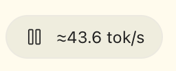
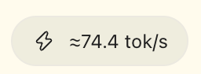
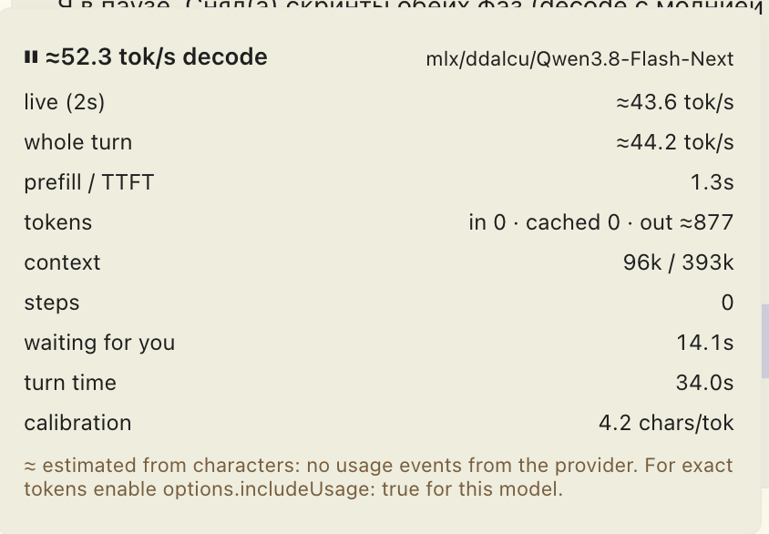

# turn-speed — live token-rate meter for Paseo agents

A composer pill per agent that shows how fast the model is actually decoding:
`⚡ 138 tok/s · 0.8k` while a turn runs, `139 tok/s · 1.2k tok` after it ends,
with a popover breakdown (prefill/TTFT, in/cached/out tokens, steps, tool wait,
context occupancy). Numbers measured from real provider usage are exact;
before the first usage event they are character estimates marked with `≈`.

## Install

```bash
paseo plugin add github:Drenalol/paseo-turn-speed
# or, from npm:
paseo plugin add npm:paseo-turn-speed
```

Then open Settings → Plugins → Turn speed to tune it. See
[Requirements](#requirements) for the one provider setting that makes the
numbers exact.

## Screenshots

Desktop — the composer pill while a turn decodes, and the paused variant
(the model is waiting for your answer):

 

The popover behind the pill — decode and whole-turn rates, prefill/TTFT,
token totals, steps, tool wait and context occupancy:



## Requirements

- Paseo **0.11.0+** (daemon and app).
- Node.js with npm on the daemon host (for the one-time `npm install` here; Paseo itself
  needs no npm to run the plugin).

## Make it work

```bash
cd /path/to/paseo-turn-speed
npm install                  # dev dependencies for typechecking only
npm run typecheck
paseo plugin install "$(pwd)"
paseo plugin reload turn-speed   # after every source edit
paseo plugin logs turn-speed
```

Then open the Paseo app: every agent with a workspace gets a pill in the composer
track (next to Tasks/Subagents). Settings → Plugins → Turn speed holds the options.

### The one setting that decides accuracy: `includeUsage`

The plugin reads real token counts from the `usage` the provider reports. For
OpenCode-backed models (including local MLX servers) the provider only forwards
usage when it is enabled in the OpenCode config, e.g. in `opencode.json`:

```json
{
  "provider": {
    "mlx": {
      "options": { "includeUsage": true }
    }
  }
}
```

Without it the plugin still works: every number is estimated from streamed
characters (`≈`) and the popover shows a hint about this setting.

Also useful: a `limit.context` value for the model (the model catalog or the
provider config) — it feeds the `context 34k / 131k` line in the popover.

## How the numbers are computed

- **TTFT / prefill** — from turn start to the first streamed character. Reported
  separately, never mixed into tok/s.
- **decode tok/s** — output tokens from usage deltas divided by decode windows
  only. Tool waits, thinking pauses longer than 2 s, and the prefill of the next
  model call are excluded. This is why the pill shows ~139 tok/s on short
  answers instead of 6.
- **Whole-turn tok/s** — optional alternative basis in settings; it includes
  tool time and is always lower. Time spent waiting for you is excluded.
- **Waiting for you** — when the model asks a question or waits for a permission
  or plan approval it is asleep until you answer. Those intervals are taken from
  the provider's permission/question requests (and restored from agent snapshots
  after reloads and reconnects), and are removed from decode windows, tool-wait
  time and the whole-turn rate. `turn time` stays wall-clock; the popover shows a
  separate `waiting for you` row and the pill switches to a ⏸ icon meanwhile.
- **Live number inside a model call** — real tokens only arrive at the end of a
  call, so the live value estimates tokens from characters over a 1/2/5 s
  smoothing window and is marked `≈` until the call's usage lands.
- **Implausible rates are dropped** — a step implying a decode faster than the
  configured limit (default 400 tok/s) cannot have happened on your hardware;
  it is almost always the previous (interrupted) message's usage arriving late.
  Such deltas are absorbed into the baseline instead of inflating the rate, and
  a note lands in the app log (`turn-speed: step dropped as implausible`).
- **Auto-calibration** — at every step end the observed `chars/token` ratio for
  the model is blended into a stored per-model calibration (EMA 0.7/0.3, clamped
  to 2..8, persisted in plugin settings). After 2–3 steps the live estimate
  tracks the real one closely. Settings → Turn speed shows and can override it.

## Settings (Settings → Plugins → Turn speed)

| Option | Default | Effect |
| --- | --- | --- |
| Show pills for idle agents | off | otherwise pills appear only around observed turns |
| Speed basis | Decode time only | decode windows vs whole-turn active time for finished turns |
| Token format | 1.2k | compact or grouped digits |
| Live smoothing window | 2 s | averaging window of the live tok/s |
| Manual chars per token | off (auto-calibrated) | override the live character estimate |
| Implausible rate limit | 400 tok/s | steps implying a faster decode are dropped as misattributed usage |

## Development

```bash
npm run verify      # typecheck + unit tests + client-bundle check
paseo plugin reload turn-speed
paseo plugin ls     # status of every installed plugin
```

`npm run check:client` compiles the client entry with the same options Paseo's
compiler uses and rejects output the mobile app's JS engine (Hermes) cannot
parse — notably anonymous class expressions, which is exactly what a `class`
becomes after bundling. Client code therefore uses closure factories instead of
classes. With a `hermes` binary available, `HERMES_BIN=/path/to/hermes npm run
check:client` runs the real Hermes syntax check too.

## Known limitations

- Usage arrives via agent snapshots, so step boundaries are as fine as the
  provider's per-call usage updates. Providers without usage at all stay `≈`.
- The plugin only counts what it watches live: after a reload or a reconnect the
  interrupted turn is not reconstructed (final `lastUsage` still gives totals).
- Subagent turns get their own pills and are never added to the parent's numbers.
- Usage that arrives late from a previous turn (typically after an interrupted
  message) is dropped by the plausibility guard, so that turn's token totals can
  be slightly low; rates stay honest.
- Every closed and dropped step is logged to the app log
  (`~/Library/Logs/Paseo/main.log`, prefix `turn-speed:`) if you want to audit
  where a number came from.
